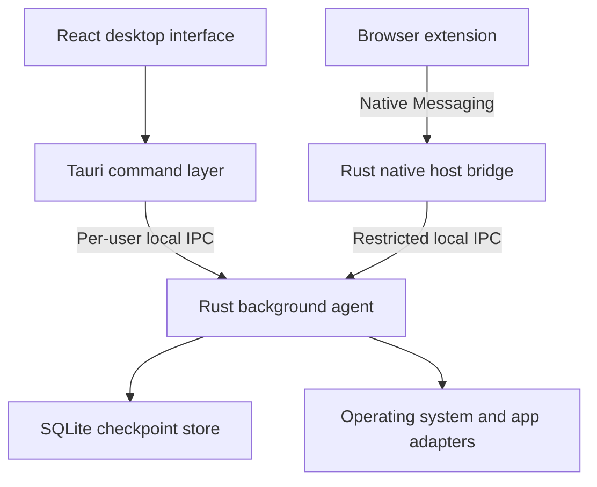

# Architecture

## Process topology

IPC means inter-process communication. On Linux, the first target, the agent listens on per-user Unix domain sockets in `$XDG_RUNTIME_DIR/reopen/` and verifies each caller's UID with `SO_PEERCRED`; see [Protocols and contracts](PROTOCOL.md#local-sockets-on-linux). No local HTTP server or open network port is required. Other platforms supply their own transport behind the same framing (see [Later platform adapters](#later-platform-adapters)).

## Responsibilities

| Component | Owns | Must not own |
| --- | --- | --- |
| Rust agent | Scheduling, capture, storage, restore plans, launch policy | Webview rendering |
| Tauri shell | Tray, explicit UI opening, narrow command forwarding | Separate checkpoint writer |
| React frontend | Preview, selection, settings and status | Executable launch authority |
| Native bridge | Browser framing, restricted forwarding, delivery | Desktop launch commands or database access |
| Extension | Browser state, permitted browser restoration | Filesystem scanning or OS app launching |
| Platform adapters | Native app/window discovery and supported launch operations | Product-level retention policy |

## Desktop lifetime

The desktop executable has a tray-only mode and creates a webview only when requested. Closing its window destroys the webview while the tray and agent remain. The agent is a separate per-user binary with its own lifetime, not a child that exits with the UI.

At login, a per-user startup entry (an XDG autostart `.desktop` file on Linux) invokes the desktop launcher in tray mode, which ensures one agent exists. Stock GNOME has no tray; the fallback is decided in task 4.1. Browser bridge startup never silently launches the desktop or restores resources. If the agent is absent, the bridge reports unavailable and the extension buffers only its latest state.

Use per-user singleton locks for agent and shell (on Linux, `flock` on files in `$XDG_RUNTIME_DIR/reopen/`). Startup races wait for a readiness handshake, not a fixed sleep. Explicit agent quit sets a stop/suppression state so automatic reconnects do not immediately restart it. A deliberate desktop launch or subsequent login can clear that state.

The agent acquires its lock, validates storage, applies migrations, protects the prior recovery candidate and records a new session before enabling capture. Graceful shutdown marks the session clean. A missing marker indicates an unclean exit, not proof of system failure. Offer previous-session recovery after clean exits too.

## Agent modules

- `capture`: provider orchestration, bounded timeouts, freshness and completeness.
- `store`: single SQLite writer, transactions, migrations and retention.
- `recovery`: candidate protection and checkpoint selection.
- `restore`: immutable plans, action journal, duplicate detection and launch pacing.
- `browser`: registered sources, connection leases, staging and browser-only dispatch.
- `memory`: selective system sampling, pressure state and warning cooldown.
- `ipc`: authentication context, role routing, schemas and bounded queues.
- `platform`: adapter traits and explicit capability discovery.

Use Tokio for timers and local IPC, with bounded channels. Move blocking SQLite calls to a dedicated writer thread and blocking platform probes to bounded workers. Serialize capture cycles; if one is still running, coalesce the next tick rather than queue indefinitely. Capture cadence and memory sampling use separate schedules.

## Supported capability model

An adapter returns capabilities such as `discover_app`, `discover_project`, `restore_app`, `restore_project`, `detect_existing` and later `restore_geometry`. Every captured resource records its adapter and schema version. Missing capability produces an unsupported/skipped result, never guessed behavior.

`sysinfo` supplies process and memory data; on Linux, `/proc/pressure/memory` adds a pressure signal where available. Visible application discovery still requires platform APIs. GNOME on Wayland exposes no global window list to ordinary clients, so the Linux window-discovery approach is an explicit spike (task 2.1) and may report `unsupported` rather than guess. Do not store every process as an app or infer open resources from arbitrary process command lines.

## Failure isolation

Browser disconnects do not interrupt desktop capture. UI crashes do not interrupt the agent. A provider timeout creates a partial checkpoint with source status. Disk-full or database errors preserve existing checkpoints and disable successful-save indicators. Bounded queues discard superseded pending captures, never committed history.

The agent owns all database access. Tauri commands and bridge traffic go through role-specific socket handlers. Packaging may bundle binaries using Tauri external binaries, but process lifetime remains explicitly managed; do not assume a generic sidecar process is independently persistent.

## Later platform adapters

Linux (Fedora/GNOME Wayland) is the first platform; see [ADR-009](DECISIONS.md#adr-009-linuxgnome-wayland-and-brave-first). The following designs are retained for Phase 7 and are not implemented first:

- **Windows 11:** named pipes restricted to the current user's security identifier replace Unix sockets, with the same four-byte little-endian framing and role-specific endpoints. Login startup uses a per-user startup entry, never an elevated service. Native-host manifests are registered under per-user registry keys. Window discovery uses Win32 visible top-level windows inside `platform-windows`.
- **macOS:** Unix sockets with peer credential checks, per-user host manifests, and a signed application bundle.
