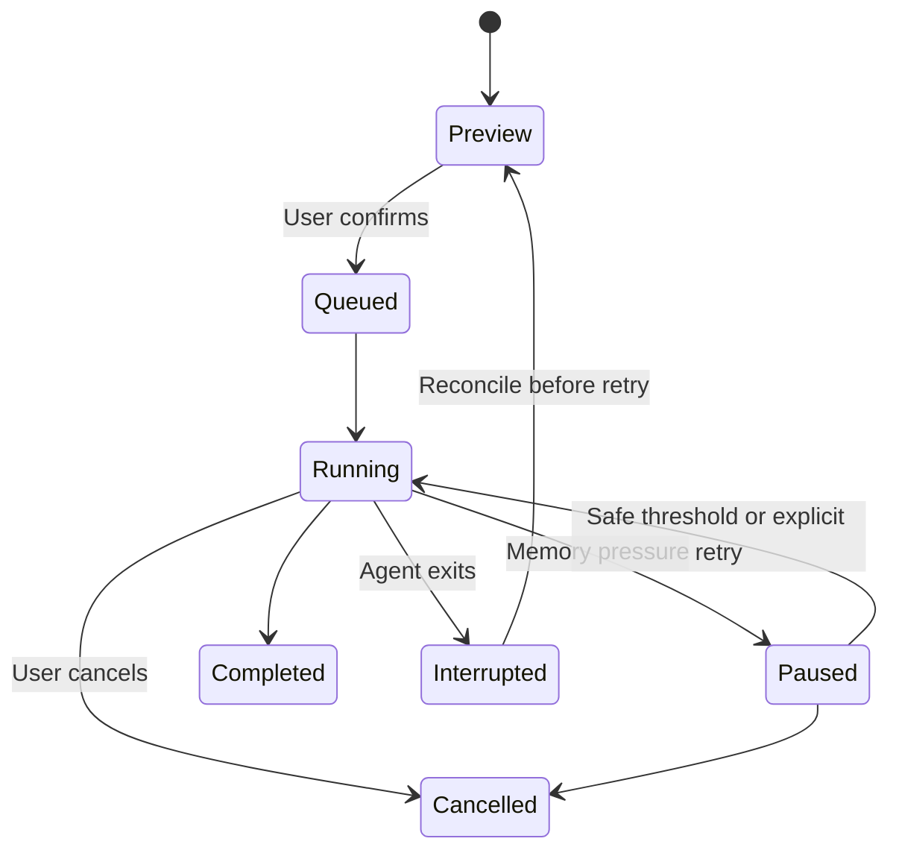

# Capture and restoration behavior

## Capture pipeline

1. On each 60-second tick, start a cycle only if none is running. Debounce meaningful browser changes; do not write once per tab event.
2. Enumerate visible user application windows through the platform adapter. Exclude system/background processes and excluded apps.
3. Resolve executable/app identity and ask supported adapters for resources.
4. Combine latest accepted browser captures with explicit freshness and connectivity metadata.
5. Apply exclusion policy, normalize identities, bound payload size and record provider failures.
6. Commit a versioned checkpoint atomically and update visible health status.

Initial provider deadline: 5 seconds each, 10 seconds overall. A timeout produces partial state and a stable error code. Avoid exhaustive command-line collection, file-handle scanning or high-frequency window polling. On memory pressure, preserve a lightweight app inventory if possible and skip expensive probes with explicit partial status. Do not promise an emergency capture can run during a freeze.

## Resource types

| Kind | Capture | Restore |
| --- | --- | --- |
| Application | Adapter identity and validated executable reference | Launch supported executable without arbitrary stored arguments |
| Project/document | Resource path from a supported app adapter | Adapter-specific argument vector |
| Folder | Proven filesystem folder path | Open via supported file-manager adapter |
| Browser tab | Source, window key, order, address, pinned/active state | Dispatch to the matching extension source |
| Terminal context, later | Explicitly registered working directory and shell identity | Open a directory, never replay history |
| Geometry, later | Bounds, display identity, window state | Clamp to currently available displays |

Do not assume window titles reveal trustworthy document paths. Do not assume every editor exposes all open projects externally. Missing resource discovery still permits app-only restore with a capability warning.

## Restore lifecycle

Action states: `pending`, `launching`, `restored`, `already_open`, `failed`, `skipped`, `uncertain`. Persist an attempt marker before a side effect, then persist its result. On restart, reconcile `launching` actions; never blindly replay them.

## Execution policy

- Launch serially with a minimum 2-second gap; wait longer for heavy apps and readiness signals.
- Check available memory before each next action. Pause with hysteresis and a clear explanation; sampling is advisory and cannot predict allocation spikes perfectly.
- Browser restoration uses small batches, initially five tabs, with pacing. A missing source pauses/skips browser actions while other app actions may proceed.
- Group resources by adapter and app to avoid launching an editor separately for each project unless its adapter requires it.
- Prefer user-selected essentials first; default order is projects/folders, remaining apps, then browser tabs.
- Cancellation prevents future side effects and reports already-completed ones honestly.
- Never automatically close windows, kill processes or restart a build to make room.

## Duplicate detection

Process identity alone is insufficient for document/project duplicates. Use normalized app identity plus adapter-confirmed resource identity. For browser tabs, compare exact normalized addresses within the intended source; preserve paths, query strings and fragments unless a documented rule proves equivalence. Do not strip potentially meaningful URL data.

If duplicate detection is unsupported or uncertain, show the limitation and let the user choose. Keep browser profile sources separate. Browser window/tab IDs from a previous session are grouping keys only, not valid current API IDs.

## Restore validation

Check schema version, adapter compatibility, exclusions, path existence and executable identity at restore time. Reject changed/missing app references rather than searching for an arbitrary same-named executable. Use argument arrays and native APIs, never shell string concatenation. Warn/skip network shares and removable resources that are unavailable without blocking the queue indefinitely.

Supported browser schemes initially: `https:` and `http:` plus internal handling for an empty new tab. Skip `javascript:`, `data:`, extension pages, browser settings and `file:` addresses. Downloads, forms, page scroll and authenticated session state are outside the initial contract.
